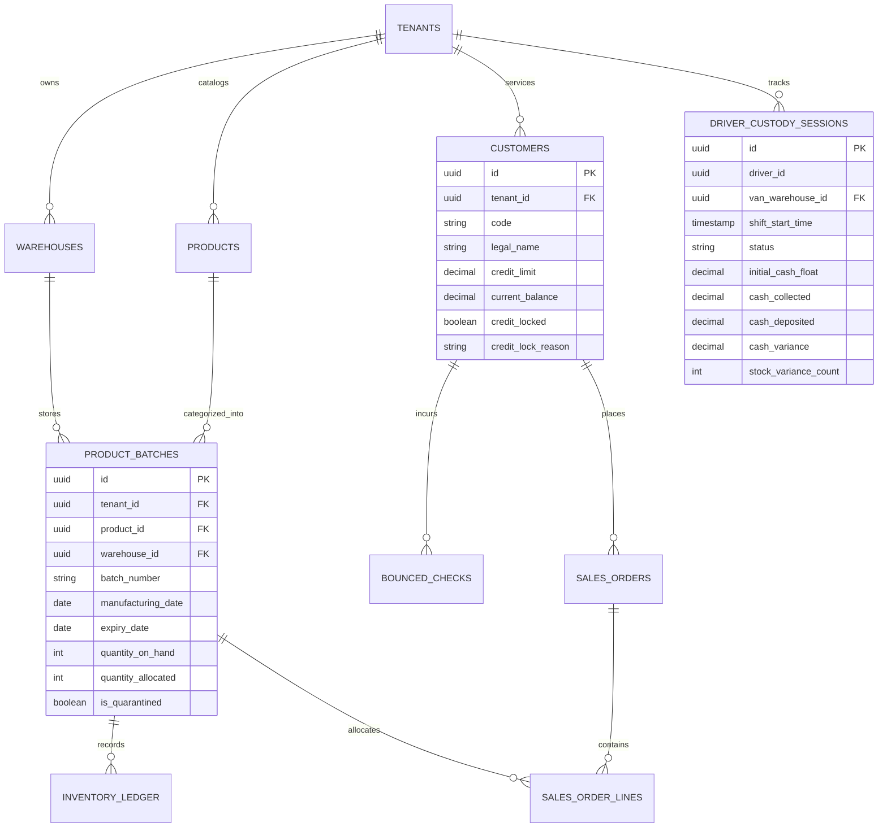
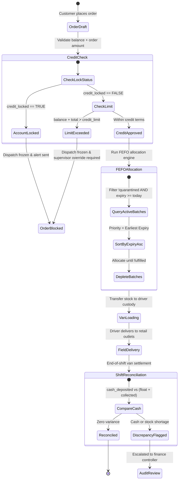

# FMCG ERP Core Architecture
> **Production-grade reference implementation of a multi-tenant wholesale FMCG ERP backend: FEFO inventory batch allocation, driver cash/stock custody ledger, bounced-check auto credit freeze, and UBL 2.1 e-invoicing.**

[](https://github.com/osama1404/fmcg-erp-core-architecture/actions)
[](https://www.typescriptlang.org/)
[](https://nodejs.org/)
[](https://www.postgresql.org/)
[](https://supabase.com/)
[](LICENSE)

---

## 📋 Executive Overview

Wholesale Fast-Moving Consumer Goods (FMCG) distribution in the GCC and MENA regions operates under unforgiving real-world constraints:
1. **Perishable Stock Expiration Risk:** Products like fresh dairy, chilled beverages, and packaged foods have short shelf lives. Traditional FIFO (First-In, First-Out) leads to spoilage when older production batches arrive late or are missed. Strict **FEFO (First-Expired, First-Out)** batch allocation is non-negotiable.
2. **Van-Sales Settlement Leakage:** Field drivers operate as mobile mini-warehouses handling physical stock dispatch and cash collections. Discrepancies between stock loaded, cash collected, and returns at shift closure erode operating margins.
3. **Credit Risk & Post-Dated Checks (PDC):** B2B buyers frequently pay with post-dated checks. When a check bounces, traditional ERPs rely on manual ledger adjustments hours or days later. This system introduces an **automated credit freeze trigger** that instantly locks customer accounts upon check return.
4. **Mandatory E-Invoicing (ZATCA & UAE FTA):** Requires cryptographic UBL 2.1 XML invoices with embedded SHA-256 digests and line-item tax calculation.

This repository provides an audited, production-grade reference architecture solving these exact domain bottlenecks.

---

## 🏛️ System Architecture

### 1. Entity-Relationship Diagram (ERD)



---

### 2. Order-to-Cash Settlement & Risk State Machine



---

## ⚡ Core Domain Engines

### 1. FEFO Batch Allocation Algorithm (`src/modules/fefo/fefoAllocator.ts`)
* Filters out quarantined batches (`is_quarantined = TRUE`) and expired goods.
* Orders batches strictly ascending by `expiry_date`.
* Consumes nearest-expiring batches first across warehouses, ensuring zero wasted inventory.

### 2. Driver Custody Settlement Ledger (`src/modules/custody/driverCustodyService.ts`)
* Tracks mobile van sales shifts from start to end.
* Compares `cash_deposited` against `initial_cash_float + cash_collected`.
* Cross-references physical return counts against calculated stock deltas.
* Flags `DISCREPANCY_FLAGGED` atomically if variances occur.

### 3. Automated Credit Freeze on Bounced Check (`src/modules/credit/creditLockService.ts`)
* Ingests bank return notification (`INSUFFICIENT_FUNDS`, `SIGNATURE_MISMATCH`, etc.).
* Sets `credit_locked = TRUE` on customer record via SQL trigger / transactional service.
* Halts any pending order dispatches and blocks future orders until resolved by credit committee.

### 4. ZATCA / UAE FTA Compliant UBL 2.1 E-Invoicing (`src/modules/einvoicing/ublXmlGenerator.ts`)
* Generates standard UBL 2.1 Invoice XML with mandatory FTA extensions.
* Calculates canonical SHA-256 digest of invoice payload.
* Outputs ready-to-sign XML for tax authority integration.

---

## 🚀 Quickstart & Runnable Verification

### Prerequisites
- Node.js 18+ (tested on Node.js 20 & 22)
- npm 9+

### 1. Installation & Build
```bash
# Clone the repository
git clone https://github.com/osama1404/fmcg-erp-core-architecture.git
cd fmcg-erp-core-architecture

# Install dependencies
npm install

# Compile TypeScript
npm run build
```

### 2. Run Comprehensive Test Suite
```bash
npm test
```
**Expected Output:**
```text
🧪 Starting FMCG ERP Core Test Suite...

▶ Test 1: First-Expired, First-Out (FEFO) Allocation Verification
  ✔ Passed: Priority 1 batch depleted first, overflow routed to Priority 2.

▶ Test 2: Driver Shift Custody Cash & Stock Reconciliation
  ✔ Passed: -50.00 AED cash variance detected, session flagged for auditor review.

▶ Test 3: Bounced Check Automated Customer Credit Lockdown
  ✔ Passed: Customer credit locked instantly, subsequent order successfully blocked.

▶ Test 4: ZATCA / UAE FTA Compliant UBL 2.1 E-Invoice Generation
  ✔ Passed: UBL 2.1 XML generated, SHA-256 digest calculated

🎉 ALL FMCG ERP CORE ARCHITECTURE TESTS PASSED SUCCESSFULLY!
```

### 3. Start Local API Server
```bash
npm start
# Server listens on http://localhost:4000
```

---

## 📡 API Reference

### Allocate Order via FEFO
`POST /api/v1/orders/fefo-allocate`
```json
{
  "tenantId": "ten-uae-fmcg-001",
  "warehouseId": "wh-dubai-central",
  "items": [
    {
      "productId": "prod-milk-fullcream-2l",
      "quantity": 50
    }
  ]
}
```

### Reconcile Driver Van Shift
`POST /api/v1/drivers/reconcile-shift`
```json
{
  "sessionId": "session-shift-20261124-01",
  "cashDeposited": 4700.00,
  "physicalStockCount": [
    {
      "productId": "prod-milk-fullcream-2l",
      "actualQuantity": 10,
      "expectedQuantity": 10
    }
  ],
  "reconciledBy": "auditor-salem"
}
```

### Process Bounced Check & Trigger Lock
`POST /api/v1/credit/process-bounced-check`
```json
{
  "tenantId": "ten-uae-fmcg-001",
  "customerId": "cust-karama-minimarket",
  "checkNumber": "CHK-ENBD-99182",
  "bankName": "Emirates NBD",
  "amount": 8500.00,
  "returnReasonCode": "INSUFFICIENT_FUNDS"
}
```

---

## 📄 License
This project is licensed under the MIT License - see the [LICENSE](LICENSE) file for details.
